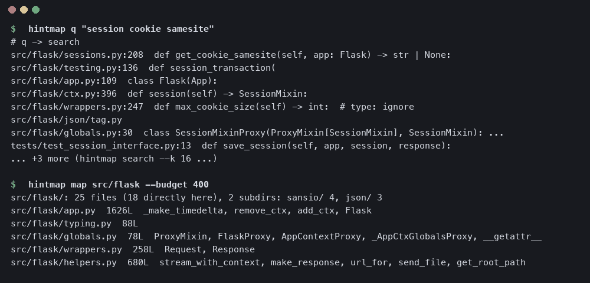
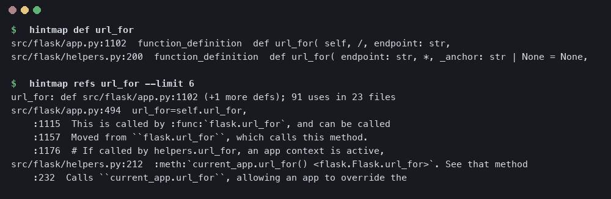
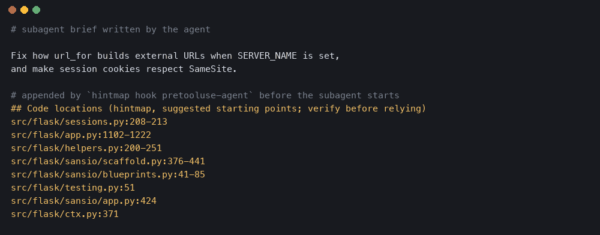

# hintmap

A deterministic, local code index for coding agents. It indexes a repository (tree-sitter symbols, call/import edges, SQLite FTS5, small static embeddings, optional git-history channel), answers navigation queries from that index, and can inject a short "Code locations" block into an agent's brief through Claude Code hooks. Everything it returns is derived from the repo itself; it keeps no memory and never edits your code.

Python 3 standard library for the query path; the graph build uses a small uv-managed venv (tree-sitter grammars + numpy).

## Install

    git clone <this repo> && cd hintmap
    mkdir -p ~/.local/bin && ln -s "$PWD/hintmap" ~/.local/bin/hintmap
    hintmap venv            # builds ~/.hintmap/venv (needs uv)
    cd /path/to/your/repo
    hintmap graph init      # registers + indexes the repo; `hintmap graph build` refreshes it
    hintmap --selftest      # sanity check

Optional vector channel: `hintmap graph model` exports the `minishlab/potion-code-16M-v2` static embedding model from your local Hugging Face cache (no download is attempted; `--src DIR` takes any model2vec directory). Without it retrieval is lexical + symbol + graph only.

Languages without a grammar wheel in the venv are indexed file-level only (`uv pip install -p ~/.hintmap/venv/bin/python tree-sitter-<lang>` to add one).

## Commands

- Index: `graph init|build [--full]|stats|audit|model`, `doctor [--fix]`, `venv`
- Graph queries: `impact SYM`, `tests-for FILE`, `edit-check SYM`, `callees SYM`, `changed [REV]`
- Lookups: `def SYM`, `refs SYM [--limit N|--all]`, `show SYM|path:line [--max N]`
- Search and maps: `search TEXT [--k 8] [--terms]`, `map [DIR|FILE] [--budget TOKENS]`, `q ANYTHING` (router: path:line -> show, path -> map, known symbol -> def+refs, else search)
- Hooks and telemetry: `hook EVENT`, `bench-hook ROOT`, `report`

Every listing has a budget and prints what it cut. Lines always come from the live file; an edited file is re-indexed before `def`/`show` answer.

## Claude Code hooks (optional)

In `~/.claude/settings.json`:

    "hooks": {
      "PreToolUse": [
        {"matcher": "Agent", "hooks": [{"type": "command", "command": "$HOME/.local/bin/hintmap hook pretooluse-agent"}]},
        {"matcher": "Bash|Grep|Read", "hooks": [{"type": "command", "command": "$HOME/.local/bin/hintmap hook pretooluse-bash"}]}
      ],
      "SessionStart": [{"hooks": [{"type": "command", "command": "$HOME/.local/bin/hintmap hook session-start"}]}],
      "SubagentStart": [{"hooks": [{"type": "command", "command": "$HOME/.local/bin/hintmap hook subagent-start"}]}]
    }

- `pretooluse-agent` appends `## Code locations (hintmap, ...)` (ranked files/symbols, a few hundred tokens) to the brief of a subagent. It only fires for subagent types listed in `HINTMAP_AGENT_TYPES` (comma list, default `general-purpose`), and only for repos you registered with `graph init`.
- `pretooluse-bash` adds references context on a single-identifier grep; a whole-file read of 400+ lines of indexed code is allowed and logged (denied only with `HINTMAP_JIT_DENY=1`).
- `session-start` refreshes a registered index and prints nothing; `subagent-start` adds a two-line pointer to the tools above.
- Kill switches: `HINTMAP_HOOK_DISABLED=1`, `touch ~/.hintmap/hook-disabled`, `HINTMAP_JIT=0`, `HINTMAP_POINTER=0`. Hooks fail open.
- A/B: `HINTMAP_HOLDOUT_PCT=N` withholds injection from N% of agents (deterministic per agent id) so `hintmap report` can compare arms; default 0 (always inject). Hook events are logged to `~/.hintmap/injections.jsonl`.

## Data and environment

- `~/.hintmap/` (`HINTMAP_HOME`): `graphs` (registry of roots), `injections.jsonl`, `potion.*` (embedding model), `venv/`.
- `<root>/.hintmap/`: graph.db and build stamps; derived and deletable, with a self-ignoring `.gitignore`.
- Other env: `HINTMAP_CHANNELS`, `HINTMAP_HUB_MIN`, `HINTMAP_GRAPH_PY`, `HINTMAP_NO_HEAVY_LOCK`.

## Layout

`hintmap` (launcher), `hintmap.py` (shim with the hook fast path), `hm/` (`common` -> `index` -> `graph` -> `hook` -> `jit` -> `term` -> `nav` -> `cli`; dependencies point one way), `hm/selftest.py` (`hintmap --selftest`).

## Benchmarks

File localisation on SWE-bench Lite: given an issue, rank the repository's files; the ground truth is the set of files the task's gold patch edits (from the public `princeton-nlp/SWE-bench_Lite` dataset). 94 tasks (100 sampled, stratified by repo, seed 20261005; 6 dropped for every arm by a cache error). Mean with 95% bootstrap CI over tasks.

| arm | Hit@1 | Hit@5 | Hit@10 | MRR | query p50 |
|---|---|---|---|---|---|
| **hintmap** | **0.479** [0.383, 0.574] | **0.723** [0.628, 0.809] | **0.840** [0.766, 0.904] | **0.589** [0.507, 0.673] | 42 ms |
| semble 0.6.1 | 0.415 [0.319, 0.521] | 0.660 [0.564, 0.755] | 0.734 [0.638, 0.819] | 0.524 [0.435, 0.610] | 134 ms |
| BM25 (SQLite FTS5, whole files) | 0.128 [0.064, 0.191] | 0.340 [0.245, 0.436] | 0.489 [0.383, 0.585] | 0.216 [0.154, 0.286] | – |

Paired against hintmap: BM25 is lower on every metric (MRR −0.373 [−0.467, −0.283]); semble's gap on the full issue text is not significant (MRR −0.065 [−0.139, +0.016]), and significant when the query is cut to the first 300 characters (MRR −0.096 [−0.182, −0.014]). Index build p50 is 14.8 s per repo@commit. Latencies were measured under concurrent load, so read them as upper bounds. Full table: `bench/RESULTS.md`.

Reproduce: `python3 bench/public_bench.py` (needs git, network, uv and the hintmap venv; checkouts are cached under `~/.cache/hintmap-bench`).

## License

MIT
